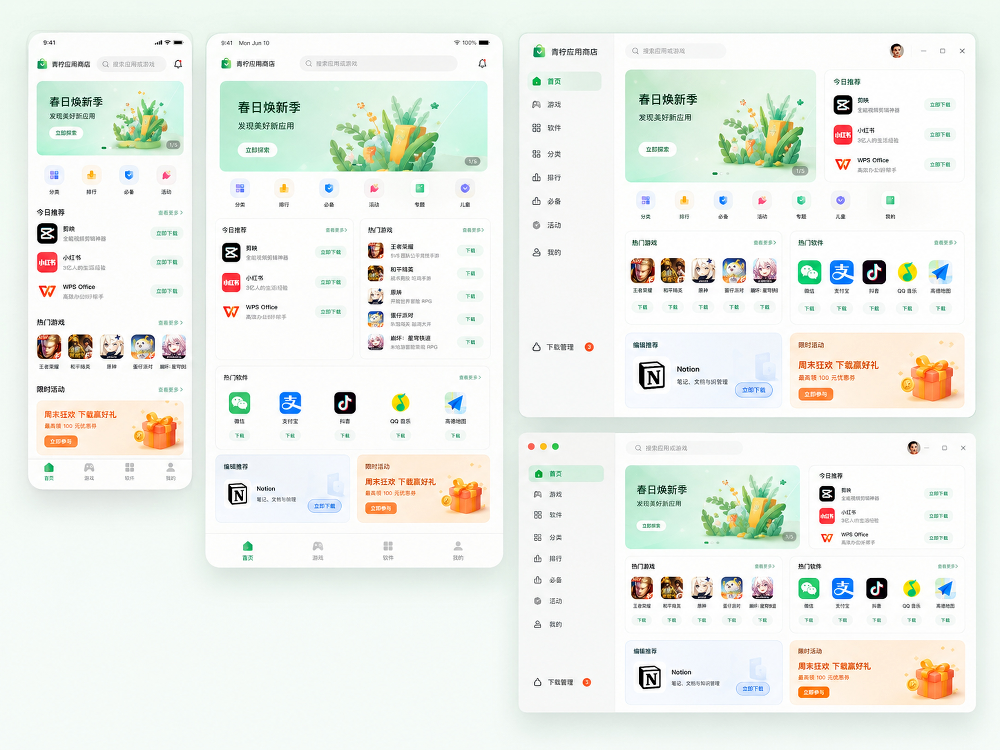
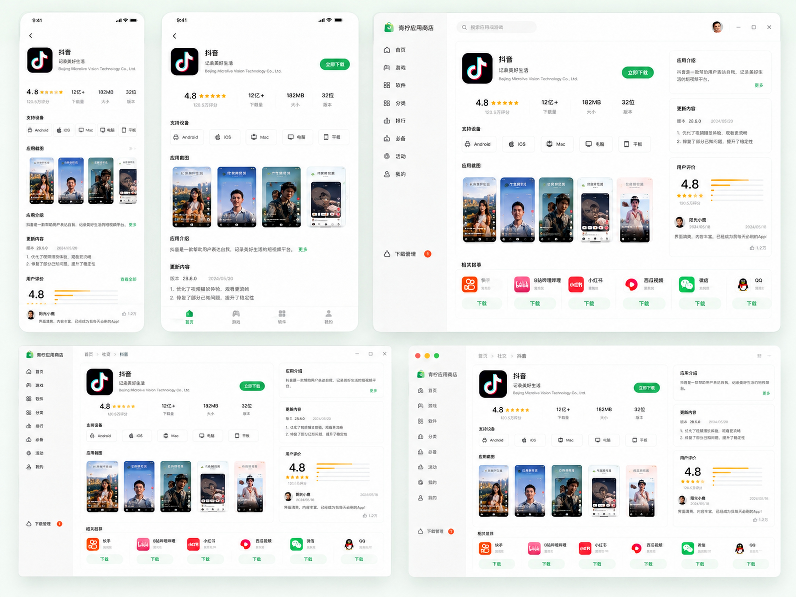
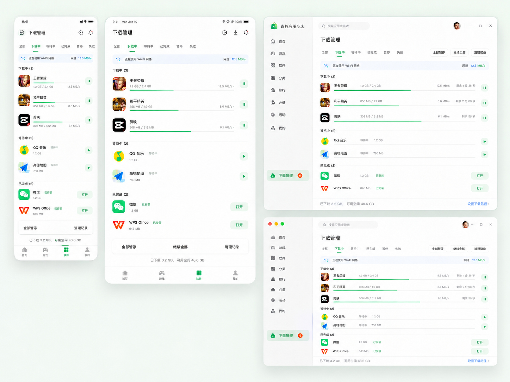
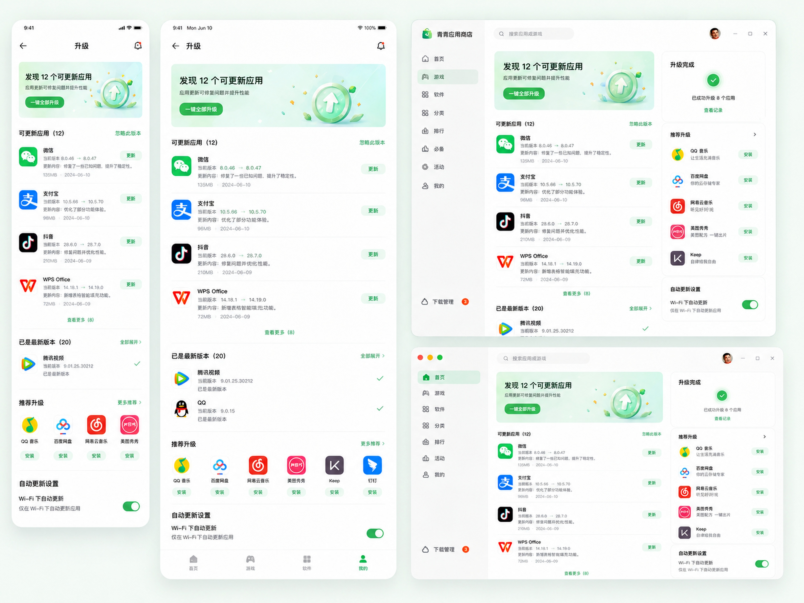
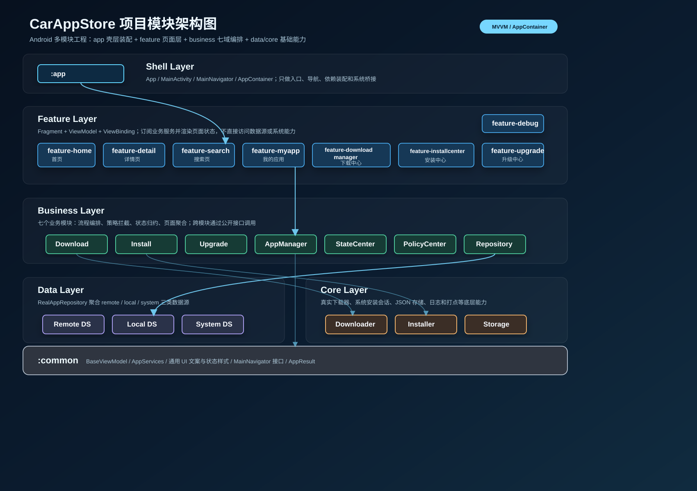

<p align="center">
  <h1 align="center">CarAppStore</h1>
  <p align="center">
    <b>跨平台应用分发与管理 App · Android 客户端实现</b><br/>
    应用目录 → 下载 → 安装 → 升级 → 状态与策略，一条主链路贯通手机、平板与桌面级大屏
  </p>
</p>

<p align="center">
  
  
  
  
  
</p>

## 简介

CarAppStore 是一个跨平台应用分发与管理 App 的 Android 客户端实现。它把**应用目录、下载、安装、升级、状态归约、策略门控**和**任务中心**串成一条完整闭环：后端下发目录，客户端按策略拉取并校验 APK，通过系统 `PackageInstaller` 完成安装，再由状态中心把下载 / 安装 / 升级的运行态归约成页面上的主按钮与状态文案。

仓库当前交付的是 Android / Kotlin 客户端。手机、平板、桌面级大屏共享同一组页面与业务状态；车载 OEM 车况、驻车 / 行车语义属于**可选平台适配**，不是产品定义，也不是通用版本的发布前提。

产品边界与术语以 [docs/00-产品定位与平台边界.md](docs/00-产品定位与平台边界.md) 为准。

## 界面设计参考

> 下列为界面设计稿，用于表达多终端布局意图；实际实现以仓库内 `layout/`、`layout-sw600dp/`、`layout-sw900dp-land/` 资源为准。

| 多终端壳层 | 首页与应用卡片 |
| --- | --- |
|  |  |

| 下载中心 | 升级中心 |
| --- | --- |
|  |  |

完整设计稿见 [docs/设计](docs/设计)，响应式布局规范见 [docs/设计/首页响应式设计规范.md](docs/设计/首页响应式设计规范.md)。

## 核心能力

**目录与分发**
- 远端目录 `HTTP → 磁盘缓存 → 内置 raw 资源` 三级回退，支持 ETag / Last-Modified 条件请求
- 可见目录的内存缓存以「请求指纹（endpoint + headers，含灰度头）+ 数据来源」为键：远端结果 30s、降级结果 3s，指纹不匹配立即失效
- Android 条目的信任元数据在**目录解析阶段**强制：必须提供正数 `versionCode` 与至少一个签名证书 SHA-256 摘要
- 运营治理字段本地生效：灰度、黑白名单、隐藏 / 下架、回滚版本

**下载**
- 真实 HTTP 下载、Range 断点续传、分片下载、合并校验、暂停 / 取消、失败恢复
- HEAD / GET / Range 请求统一携带运行时短期凭据，手动逐跳跟随重定向并按 origin 决定是否转发凭证
- 写盘失败独立归类（`STORAGE_IO` / `STORAGE_INSUFFICIENT`），不与网络错误混用
- 下载任务目录通过任务 ID 白名单 + canonical path containment 双层防护

**安装**
- `PackageInstaller.Session` 安装链路、用户确认页分发、安装会话持久化与会话冷启动对账
- 创建 Session 前校验 APK 包名、`versionCode`、签名证书；安装成功后以 PackageManager 事实收口
- 安装失败按类型归约：环境类（策略拦截）保留重试安装，产物不一致引导重新下载，平台 / 系统能力缺失直接置灰

**升级**
- 单个 / 批量升级检测与串行执行，目标版本号与执行权双重去重
- 下载前、进入安装前、等待下载与等待安装四个节点复查策略，中途失效以 `POLICY_BLOCKED` 收敛并保留重试
- staged 目标版本在成功与失败路径都会消费，失败不会污染下一次普通安装的版本比对

**状态与策略**
- `StateCenter` + `StateReducer` 统一归约下载 / 安装 / 升级运行态，输出页面主按钮与状态文案
- `PolicyCenter` 统一处理 Wi-Fi、存储与按平台启用的附加策略，策略与平台能力解耦

**多端 UI**
- 首页、搜索、详情、我的应用、下载中心、安装中心、升级中心、开发者设置共 8 个页面
- 手机、平板、桌面级大屏 / 横屏扩展窗口三套布局壳层，扩展窗口提供侧边导航与任务摘要栏

**观测与安全**
- 页面曝光、主动作点击、下载 / 安装 / 升级结果本地事件落盘；未被上报通道接收的事件进入有界队列（200 条）重试
- 生产目录 / CDN / 认证 / 签名门禁由 `verifyProductionConfig` 与 `verify-production-readiness.ps1` 强制，密钥不进入仓库
- Release 固定生产环境并使用安全空目录回退，LOCAL_SIM 目录与调试能力仅在 Debug 生效

## 技术栈

| 类别 | 选型 |
| --- | --- |
| 语言 | Kotlin 2.0.0 |
| 构建 | Gradle 8.14.3 · Android Gradle Plugin 8.13.2 |
| JDK | 21（`compileOptions` / `jvmTarget` / CI 基线一致） |
| SDK | compileSdk 36 · targetSdk 36 · minSdk 26 |
| 架构 | MVVM + 单向数据流，手动依赖装配（`AppContainer`） |
| 导航 | `Activity + FragmentManager`（不引入 Navigation） |
| 依赖注入 | 手动装配（不引入 Hilt / Dagger） |
| 异步 | Coroutines + Flow |
| 存储 | 自研 `VersionedJsonStore`（schema 版本 + 迁移 + 原子写 + 进程锁） |
| CI | GitHub Actions（单测 / 编译 / Lint / Debug & Release APK / 产物归档） |

## 快速开始

### 1. 环境要求

- JDK / JBR **21**（Android Studio 自带 JBR 若是 25 需单独准备 21，Gradle 8.14 不支持 25）
- Android SDK Platform 36、Build Tools 36.x、Platform Tools
- Python 3.10+（仅用于仓库自带的 `tools/` 脚本）

### 2. 环境自检

```bash
python tools/verification/check_build_env.py
```

纯只读诊断，不安装工具链、不修改仓库文件。逐项检查 `java` 版本、`JAVA_HOME`、SDK 路径与 `platforms;android-36`、`local.properties` 和 Gradle wrapper；存在失败项时退出码为 1，`--json` 可输出机器可读结果。

SDK 路径可由 `ANDROID_HOME` / `ANDROID_SDK_ROOT` 提供，也可在仓库根目录的 `local.properties` 写 `sdk.dir=<SDK 绝对路径>`（该文件已在 `.gitignore` 中，不要提交；CI 用环境变量，不需要它）。

### 3. 克隆与构建

```bash
git clone https://github.com/XZQ/CarAppStore.git
cd CarAppStore
```

Windows PowerShell：

```powershell
$env:JAVA_HOME="<your-jdk-21-path>"
.\gradlew.bat assembleDebug --no-daemon
.\gradlew.bat testDebugUnitTest testReleaseUnitTest --no-daemon
.\gradlew.bat lintDebug lintRelease --no-daemon
```

macOS / Linux / Git Bash：

```bash
./gradlew assembleDebug --no-daemon
./gradlew testDebugUnitTest testReleaseUnitTest --no-daemon
./gradlew lintDebug lintRelease --no-daemon
```

产物：`app/build/outputs/apk/debug/app-debug.apk`；`:app:assembleRelease` 在未提供签名参数时只生成未签名产物，仅用于常规工程验证。

### 4. 本地模拟跑通主链路

```bash
python tools/local-sim/generate_catalog.py
python tools/local-sim/serve.py     # 监听 0.0.0.0:8080，支持 Range
```

在 App 的「开发者设置」中切到 **LOCAL_SIM** 环境（App 会重启重建依赖容器），即可用模拟器 `10.0.2.2:8080` 访问本地目录与 APK，验证「浏览 → 详情 → 下载 → 暂停续传 → 安装」。完整步骤见 [docs/32-本地验证指南.md](docs/32-本地验证指南.md)。

### 5. 生产构建

```powershell
.\tools\production\verify-production-readiness.ps1
```

校验生产目录 / CDN 的 HTTPS 地址、目录与 CDN 认证模式、keystore / alias / password，并构建验证签名 Release APK。配置值与密钥来自安全环境注入，不写入 Git。详见 [docs/33-生产发布配置与设备验证基线.md](docs/33-生产发布配置与设备验证基线.md)。

## 架构



| 层次 | 模块 | 职责 |
| --- | --- | --- |
| 壳层 | `app` | Application、MainActivity、Fragment 导航、`AppContainer` 装配与系统桥接 |
| 特性 | `feature-*` | 8 个业务页面的 UI 与 ViewModel |
| 业务 | `business` | 下载 / 安装 / 升级 / 应用管理 / 状态中心 / 策略中心 / Repository 七大业务域编排 |
| 数据 | `data` | Repository、远端目录、本地结构化存储、系统数据源、模型映射 |
| 基础 | `core` `common` | 下载器、安装器、JSON 存储、日志打点；基类、共享 UI 与资源 |

关键设计决策：

- **MVVM + 单向数据流**：页面只订阅状态、只抛事件，不直接调用业务实现
- **手动依赖装配**：`AppContainer` 统一装配，不引入 Hilt / Dagger
- **固定页面导航**：`Activity + FragmentManager`，不引入 Navigation
- **业务边界不可破坏**：跨模块调用只走公开接口，`app` 模块不重新业务化
- **安全优先**：策略门控、APK 身份校验、失败可见性优先于运营功能

更多架构说明见 [docs/01-架构总览.md](docs/01-架构总览.md)、[docs/03-七个业务模块详解.md](docs/03-七个业务模块详解.md)、[docs/16-整体业务主链路总流程.md](docs/16-整体业务主链路总流程.md)。

## 项目结构

```text
CarAppStore/
├── app/                        # 壳层：AppContainer、MainActivity、Fragment 导航
├── common/                     # 基类、共享 UI、导航接口、通用结果类型
├── core/                       # 下载器、安装器、JSON 存储、日志与打点
├── data/                       # Repository、DataSource、本地存储、模型映射
├── business/                   # 七大业务域：download/install/upgrade/appmanager/state/policy/repository
├── feature-home/               # 首页
├── feature-detail/             # 详情页
├── feature-myapp/              # 我的应用
├── feature-search/             # 搜索页
├── feature-downloadmanager/    # 下载中心
├── feature-installcenter/      # 安装中心
├── feature-upgrade/            # 升级中心
├── feature-debug/              # 开发者设置
├── docs/                       # 架构、流程、联调与验收文档
├── tools/                      # 环境自检、本地模拟、生产门禁、设备证据采集
├── AGENTS.md                   # Agent 接手规则
├── CLAUDE.md                   # 项目级编码边界
├── build.gradle.kts            # 根构建文件
└── settings.gradle.kts         # 模块声明
```

## 文档

| 分类 | 文档 |
| --- | --- |
| 入门 | [产品定位与平台边界](docs/00-产品定位与平台边界.md) · [换机接手与当前进度总览](docs/29-换机接手与当前进度总览.md) · [当前项目状态与接手指南](docs/21-当前项目状态与接手指南.md) |
| 架构 | [架构总览](docs/01-架构总览.md) · [七个业务模块详解](docs/03-七个业务模块详解.md) · [整体业务主链路总流程](docs/16-整体业务主链路总流程.md) · [接口说明](docs/07-接口说明.md) |
| 模块 | [下载](docs/09-下载模块架构与流程.md) · [安装](docs/10-安装模块架构与流程.md) · [升级](docs/11-升级模块架构与流程.md) · [状态中心](docs/12-状态中心架构与流程.md) · [策略中心](docs/13-策略中心架构与流程.md) · [Repository](docs/15-Repository架构与流程.md) |
| 联调验收 | [远端目录接入约定](docs/23-远端目录与车况信号接入约定.md) · [联调执行清单](docs/24-后端与OEM联调执行清单.md) · [真机回归清单](docs/25-真机回归测试清单.md) · [验收标准](docs/26-后端与OEM验收标准.md) · [生产发布基线](docs/33-生产发布配置与设备验证基线.md) |
| 设计与商用 | [跨平台 UI 框架设计](docs/27-多端UI框架设计.md) · [商用化剩余事项](docs/28-商用化剩余事项.md) · [运行时短期鉴权接入](docs/35-运行时短期鉴权接入.md) |
| 审查记录 | [2026-10 深度审查](docs/36-2026-10深度审查与修复规划.md) · [2026-11 第二轮](docs/37-2026-11第二轮代码审查与修复.md) · [2026-11 第三轮 JDK 21 与 P2 收口](docs/38-2026-11第三轮JDK21与P2收口.md) |

完整索引见 [docs/README.md](docs/README.md)。

## 项目状态与外部依赖

客户端侧能力已经闭环，以下事项需要真实外部资源或目标设备才能完成，仓库内已预留接入点：

| 事项 | 归属 | 解锁条件 |
| --- | --- | --- |
| 真实远端目录 API（含 `versionCode`、签名摘要、灰度头、错误码） | 外部服务 | 后端提供正式地址与元数据并完成联调 |
| APK CDN 与运行时令牌签发 / 刷新 | 外部服务 | 提供登录会话与令牌协议 |
| 正式签名（keystore / alias / 密码） | 安全环境 | 从非仓库密钥环境注入 4 个签名变量 |
| Android 设备矩阵回归 | 真机 / QA | 覆盖安装确认页、取消、进程重建等设备证据 |
| 埋点上传与失败归因看板 | 外部平台 | 上传接口、隐私字段与告警验收 |
| 可选车载 OEM 车况信号 | 按发行目标 | 仅当发行目标包含车载设备时接真实协议 |

完整顺序与阻塞归属见 [docs/29 §5](docs/29-换机接手与当前进度总览.md) 与 [docs/28-商用化剩余事项.md](docs/28-商用化剩余事项.md)。

## 开发约定

- 提交与改动前先读 [AGENTS.md](AGENTS.md)（Agent 接手规则与硬约束）与 [CLAUDE.md](CLAUDE.md)（项目级编码边界）
- 业务域边界、依赖装配方式与导航方式不可擅自更改
- 每个提交的门禁结果以 GitHub Actions 对应 SHA 的 `carappstore-verification-<SHA>` 产物为准
- 最新进度以 `git status --short --branch` 和 `git log --oneline -5` 为准

## 许可证

本仓库暂未附带 `LICENSE` 文件，当前仅用于内部开发与联调。分发或对外使用前请先明确授权条款。
